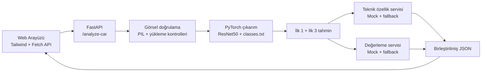

# Car Vision Project — Araç Tanıma Prototipi

**[English](README.md) | Türkçe**

[](https://www.python.org/)
[](https://pytorch.org/)
[](https://fastapi.tiangolo.com/)
[](https://www.docker.com/)
[](LICENSE)

Türkiye otomotiv pazarındaki araçları dış görünüş fotoğraflarından sınıflandırmayı amaçlayan **bilgisayarlı görü portfolyo prototipi**.

Projede özel eğitilmiş PyTorch **ResNet50** modeli, **FastAPI** üzerinden çıkarım (inference) API'si ve **Tailwind CSS** tabanlı web arayüzü bulunuyor. Tahmin sonuçları örnek teknik özellik ve değerleme kayıtlarıyla zenginleştiriliyor.

> **Önemli:** Eğitilmiş `.pth` model dosyası Git deposunda bulunmuyor. Bu dosya sağlanmadığında gerçek sınıflandırma çalışmaz. Teknik özellik ve araç değerleme çıktılarında **mock/fallback** veriler kullanılabilir; bunlar doğrulanmış güncel piyasa fiyatları değildir.

## Projenin öne çıkanları

- Türkiye pazarındaki marka/model/yıl kombinasyonları için **105 sınıflı** ResNet50 modeli.
- Model eğitimi sırasında **%60 üzeri Top-1 doğruluk** raporlanmış; model ağırlıkları ve değerlendirme veri kümesi depoda bulunmadığından bu sonuç yalnızca depoyu klonlayarak bağımsız olarak tekrar üretilemez.
- `/` konumunda web arayüzü; `/health` ve `/analyze-car` API uç noktaları.
- İlk üç tahmin (Top-3) ve güven değerlerinin gösterimi.
- Katalogda bulunmayan araç sınıfları için örnek/fallback özellik ve değerleme çıktıları.
- Docker yapılandırması ve `pytest` ile uygulama testleri.

## Sistem akışı



## Depo yapısı

```text
.
├── README.md
├── README.tr.md
├── LICENSE
├── pyproject.toml
└── car_vision_project/
    ├── api/
    ├── artifacts/         # classes.txt var; model ağırlığı Git'te yok
    ├── data/
    ├── models/
    ├── scripts/
    ├── services/
    ├── templates/
    ├── tests/
    ├── utils/
    ├── .env.example
    ├── Dockerfile
    ├── README.md         # İngilizce ayrıntılı teknik belge
    ├── requirements.txt
    ├── config.py
    └── train.py
```

## Yerel kurulum

Komutları deponun kök dizininde çalıştır.

```bash
git clone https://github.com/Merd0/car-vision-project.git
cd car-vision-project
python -m venv .venv
```

Sanal ortamı etkinleştir:

```powershell
# Windows PowerShell
.venv\Scripts\Activate.ps1
```

```bash
# macOS / Linux
source .venv/bin/activate
```

Bağımlılıkları kur:

```bash
python -m pip install --upgrade pip
python -m pip install -r car_vision_project/requirements.txt
python -m pip install -e .
```

`.env` dosyasını örnek yapılandırmadan oluştur:

```powershell
# Windows PowerShell
Copy-Item car_vision_project/.env.example .env
```

```bash
# macOS / Linux
cp car_vision_project/.env.example .env
```

## Model dosyasını hazırlama

Depoda sınıf etiketleri `car_vision_project/artifacts/classes.txt` içerisinde tutulur; ancak eğitilmiş ağırlık dosyası Git'e eklenmez.

Gerçek görüntü sınıflandırması için model checkpoint'ini şu konuma yerleştir:

```text
car_vision_project/artifacts/best_car_model.pth
```

Alternatif olarak yerel yapılandırmada `MODEL_CHECKPOINT_PATH` değişkeniyle başka bir yol tanımla.

**Model dosyası yoksa:** `GET /health` sonucunda `model_loaded: false` görülür; `POST /analyze-car` çıkarım için model bulunamadığına ilişkin hata döndürür.

## Çalıştırma

```bash
uvicorn car_vision_project.api.main:app --host 127.0.0.1 --port 8000 --reload
```

Tarayıcıdan [http://127.0.0.1:8000](http://127.0.0.1:8000) adresini aç. API'nin OpenAPI arayüzü [http://127.0.0.1:8000/docs](http://127.0.0.1:8000/docs) yolundadır.

### Docker

```bash
docker build -f car_vision_project/Dockerfile -t car-vision-api .
```

Windows PowerShell için örnek:

```powershell
docker run --rm `
  -p 8000:8000 `
  --env-file .env `
  -v "${PWD}\car_vision_project\artifacts:/app/car_vision_project/artifacts:ro" `
  car-vision-api
```

İşletim sisteminde ortam değişkeni ve volume sözdizimini uygun şekilde düzenle.

## API kullanımı

**`GET /health`** — API ve modelin hazır olup olmadığına ilişkin bilgileri döndürür. Başarılı model yüklemesi için `model_loaded: true` beklenir; model dosyası bulunmadığında değer `false` olur.

**`POST /analyze-car`** — `multipart/form-data` isteğindeki `file` görselini doğrular ve mevcut model yüklenmişse sınıflandırma yapar.

Örnek istek:

```powershell
curl.exe -X POST "http://127.0.0.1:8000/analyze-car" -F "file=@C:\path\to\car.jpg;type=image/jpeg"
```

Yanıt alanları; birincil tahmini (`prediction`), ilk üç tahmini (`top_predictions`), teknik özellikleri (`features`) ve örnek değerlemeyi (`valuation`) içerebilir.

> README'deki tahmin ve fiyat JSON'ları **temsili API örnekleridir**; yüklenebilir bir model ağırlığı, gerçek araç değeri veya canlı fiyat servisi bulunduğunu kanıtlamaz.

## Test

```bash
pytest car_vision_project/tests
```

Testler API durumunu, dosya yükleme kontrollerini, tahmin sonuçlarının yapısını ve örnek özellik/değerleme servislerini sınar. Testlerin varlığı, gerçek modelin yeniden üretilebilirliğini veya piyasa değerlerinin doğruluğunu tek başına garanti etmez.

## Teknik sınırlar

- Çıkarım için gerekli model checkpoint'i depoda yer almıyor.
- Özellik ve değerleme servisleri mock/fallback veriler kullanabiliyor.
- Başarı oranı, eğitim sonucu olarak raporlanmıştır; ağırlıklar ve veri kümesi olmadan bağımsız doğrulama sınırlıdır.
- Sistem, onaylanmış bir üretim servisi veya ticari araç fiyatlama sistemi olarak sunulmuyor.

Ayrıntılı teknik mimari ve yapılandırma için [İngilizce paket düzeyi README](car_vision_project/README.md) dosyasına geçebilirsin. **Bu bağlantı İngilizce belgeye gider.**

## Lisans

[MIT Lisansı](LICENSE).

**[English README](README.md)**
