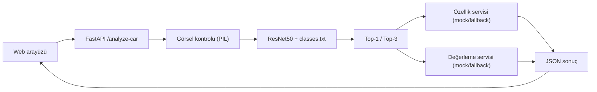

# Car Vision Project — Teknik Dokümantasyon

**[English](README.md) | Türkçe** · [Türkçe proje tanıtımı](../README.tr.md)

PyTorch ResNet50 ile eğitilen bir araç sınıflandırıcısını, FastAPI çıkarım API'sini ve Tailwind CSS tabanlı web arayüzünü birleştiren **bilgisayarlı görü prototipi**.

Bu belge, kök dizindeki [Türkçe README'nin](../README.tr.md) teknik tamamlayıcısıdır. Kod örneklerinde İngilizce değişken ve API adları orijinal biçimleriyle korunmuştur.

## Proje özeti

- Türkiye pazarına yönelik marka/model/yıl kombinasyonlarından oluşturulan **105 araç sınıfı**.
- Model için **%60+ Top-1 doğruluk** raporlanmış; depoda ağırlıklar ve değerlendirme veri kümesi bulunmadığı için sonuç tek başına bağımsız olarak yeniden üretilemez.
- `GET /health`, `POST /analyze-car` ve `/` web arayüzü.
- Birincil ve ilk üç tahminin gösterimi.
- Özellik ve fiyatlama için **mock katalog** ve genel fallback yanıtları; canlı piyasa verisi değildir.
- Docker yapılandırması, Python paketi ve `pytest` testleri.

## Mimari akış



## Temel yetenekler

**Görüntü sınıflandırma:** Dış cepheden çekilmiş araç görseli yüklenir; model mevcutsa sınıf tahmini üretilir.

**Top-K çıkarım:** Birincil tahmin ve ilk üç sınıf, modelin ürettiği güven değerleriyle döndürülür. Bu değerlerin bağımsız olarak kalibre edildiğine ilişkin kanıt depoda sunulmuyor.

**Fallback davranışı:** Tahmin edilen sınıf örnek özellik/değerleme sözlüklerinde yoksa genel veriler kullanılır. Bu mekanizma gerçek fiyat doğrulaması sağlamaz.

**Eğitim çıktıları:** Eğitim betiği çalıştırıldığında `best_car_model.pth`, `classes.txt`, `training_curves.png`, `confusion_matrix.png` ve `training_summary.json` gibi dosyalar oluşturabilir. Bunların tamamı Git deposunda hazır bulunmak zorunda değildir.

## Depo yapısı

```text
car_vision_project/
├── api/
│   └── main.py
├── artifacts/
│   └── classes.txt         # Model ağırlığı Git'te tutulmaz
├── data/
├── models/
│   └── car_classifier.py
├── scripts/
│   └── auto_scraper.py
├── services/
│   ├── feature_service.py
│   └── valuation_service.py
├── templates/
│   └── index.html
├── utils/
│   └── image_transforms.py
├── .env.example
├── Dockerfile
├── README.md
├── README.tr.md
├── requirements.txt
└── train.py
```

## Model dosyaları ve yapılandırma

- Model dosyası: `car_vision_project/artifacts/best_car_model.pth`
- Sınıflar: `car_vision_project/artifacts/classes.txt`
- Sınıf sayısı: **105**
- Giriş görsel boyutu: **224 × 224**

`classes.txt` Git üzerinden sağlanır. Eğitilmiş `.pth` checkpoint dosyası depoda bulunmaz.

Çıkarımın çalışması için modeli belirtilen dizine yerleştir veya `MODEL_CHECKPOINT_PATH` ortam değişkenini gerçek dosya yoluna ayarla.

Checkpoint yoksa `/health` içinde `model_loaded: false` beklenir; `/analyze-car` modelin kullanılamadığını bildirir.

Önemli ortam değişkenleri:

```text
API_HOST=0.0.0.0
API_PORT=8000
UVICORN_WORKERS=1
CORS_ALLOWED_ORIGINS=
MODEL_CHECKPOINT_PATH=car_vision_project/artifacts/best_car_model.pth
MODEL_CLASSES_PATH=car_vision_project/artifacts/classes.txt
MODEL_NUM_CLASSES=105
MODEL_IMAGE_SIZE=224
MODEL_DEVICE=auto
MODEL_DROPOUT=0.3
TEMPLATES_DIR=car_vision_project/templates
STATIC_DIR=car_vision_project/static
MAX_UPLOAD_SIZE_MB=10
ALLOWED_IMAGE_CONTENT_TYPES=image/jpeg,image/png,image/webp
```

## Kurulum

Depo kökünden:

```bash
git clone https://github.com/Merd0/car-vision-project.git
cd car-vision-project
python -m venv .venv
```

Windows PowerShell'de:

```powershell
.venv\Scripts\Activate.ps1
```

macOS/Linux için:

```bash
source .venv/bin/activate
```

Bağımlılıkları kur:

```bash
python -m pip install --upgrade pip
python -m pip install -r car_vision_project/requirements.txt
python -m pip install -e .
```

Ortam dosyasını oluştur:

```powershell
Copy-Item car_vision_project/.env.example .env
```

macOS/Linux karşılığı: `cp car_vision_project/.env.example .env`.

API'yi başlat:

```bash
uvicorn car_vision_project.api.main:app --host 127.0.0.1 --port 8000 --reload
```

Web arayüzü: [http://127.0.0.1:8000](http://127.0.0.1:8000) · OpenAPI: [http://127.0.0.1:8000/docs](http://127.0.0.1:8000/docs).

## Docker kullanımı

İmajı oluştur:

```bash
docker build -f car_vision_project/Dockerfile -t car-vision-api .
```

Windows PowerShell örneği:

```powershell
docker run --rm `
  -p 8000:8000 `
  --env-file .env `
  -v "${PWD}\car_vision_project\artifacts:/app/car_vision_project/artifacts:ro" `
  car-vision-api
```

Gerçek uygulamada Docker volume yolunu ve çalışma ortamını bilgisayarına göre ayarla. Çıkarım için model checkpoint'i hâlâ gereklidir.

## API belgeleri

### `GET /health`

API sağlık durumu, modelin yüklenip yüklenmediği (`model_loaded`), sınıf sayısı ve ilgili dosya yollarını bildirir.

### `POST /analyze-car`

`multipart/form-data` isteğindeki `file` alanıyla görsel yüklenir:

```powershell
curl.exe -X POST "http://127.0.0.1:8000/analyze-car" -F "file=@C:\path\to\car.jpg;type=image/jpeg"
```

Yanıtta `prediction`, `top_predictions`, `features` ve `valuation` alanları bulunabilir. Özellik ve değerleme alanları gerçek piyasa servisinin çıktıları olarak değerlendirilmemelidir.

İstek doğrulaması `image/jpeg`, `image/png` veya `image/webp` dışında bir format için hata döndürebilir. Model dosyası bulunamazsa model kullanılabilirliği hatası gösterilir.

İngilizce teknik README'deki JSON yanıtları **temsili örneklerdir**; bunları çalışma sırasında elde edilmiş bağımsız ölçüm veya fiyat doğrulaması olarak kullanma.

## Arayüz deneyimi

`/` yolu sürükle-bırak görsel yükleme, önizleme, yükleme göstergesi, birincil tahmin kartı, ilk üç sınıfın görselleştirilmesi ve özellik/değerleme kartlarını içerir.

## Eğitim akışı

Eğitim betiği önceden eğitilmiş bir **ResNet50** ile başlayarak veri artırma yöntemlerini kullanır; model ağırlıklarını ve eğitim özetlerini oluşturabilir.

```bash
python -m car_vision_project.train
```

Modelin doğruluk iddialarını değerlendirmek için eğitim verisinin, test ayrımının ve checkpoint'in erişilebilir ve tekrar üretilebilir olması gerekir.

## Testler

```bash
pytest car_vision_project/tests
```

Kapsam raporu istenirse:

```bash
pytest car_vision_project/tests --cov=car_vision_project
```

Testler API sağlık durumu, yükleme doğrulaması, ilk üç tahminin yanıt biçimi ve örnek özellik/değerleme servislerini kapsar.

## Kurulum yardımcı dosyası

Depo kökündeki `init_repo.ps1` dosyası, depoyu ilk kez hazırlama ve Git bağlantısı kurma sürecine yönelik bir yardımcı betiktir; normal kullanıcı kurulumu için zorunlu değildir.

## Lisans

[MIT](../LICENSE).

[English technical README](README.md) · [Türkçe proje tanıtımı](../README.tr.md)
